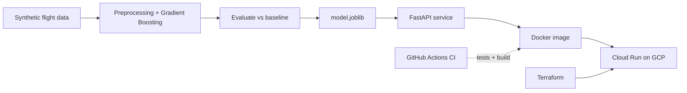

# noshow-predictor
[](https://github.com/terranceboachie/noshow-predictor/actions)

A production-style machine learning service that predicts the share of booked passengers who will not show up for a flight. It covers the full path from model to deployed API: tested Python code, REST API, Docker, CI, and infrastructure as code for Google Cloud Run.

> **Note:** the data is synthetic and generated in `noshow/data.py`. The project demonstrates the method and the engineering, not real airline accuracy.

## Why this problem

Airlines plan meals, ground staff and seat sales around how many passengers actually board. Predicting no-shows per flight turns directly into cost savings and more robust operations.

## What it does

Send details of a flight and get back the expected no-show rate and the expected number of no-shows.

```bash
curl -X POST http://localhost:8080/predict \
  -H "Content-Type: application/json" \
  -d '{"route":"AMS-LHR","hour":8,"day_of_week":4,"month":6,
       "booked_passengers":180,"advance_booking_days":40,
       "flex_share":0.3,"connecting_share":0.2}'
```

```json
{"no_show_rate": 0.063, "expected_no_shows": 11.3}
```

## Architecture



## Results

On a held-out 20% test set (synthetic data):

| Model | MAE |
|---|---|
| Baseline (always predict the mean) | 0.0139 |
| Gradient boosting pipeline | 0.0082 |

That is a 41% lower error than the baseline. A model that cannot beat the baseline is not worth deploying, so the comparison is built into `evaluate()`.

## Project structure

```
noshow/
  data.py       synthetic data generator
  features.py   feature lists and preprocessing
  model.py      NoShowModel class (fit, predict, evaluate, save, load)
  train.py      training script, writes artifacts/model.joblib + metrics.json
  api.py        FastAPI app (/health, /predict) with input validation
tests/          pytest tests for the model and the API
terraform/      Artifact Registry + Cloud Run on GCP
Dockerfile      container image (trains the model at build time)
.github/        CI: run tests and build the Docker image on every push
```

## Quickstart

```bash
pip install -r requirements-dev.txt
pytest -q                      # run tests
python -m noshow.train         # train and save the model
uvicorn noshow.api:app --reload
```

Open http://127.0.0.1:8000/docs for interactive API docs.

### Docker

```bash
docker build -t noshow-predictor .
docker run -p 8080:8080 noshow-predictor
```

### Deploy to Google Cloud

Terraform sets up the registry and a Cloud Run service that scales to zero. Step-by-step instructions are in [DEPLOY.md](DEPLOY.md).

## Design decisions

- **Preprocessing is saved with the model** in one pipeline, so training and serving cannot drift apart.
- **Unknown routes are ignored** instead of crashing the API.
- **Input validation** with pydantic rejects impossible values (for example hour 99) with a 422 error.
- **Scale to zero and a 2-instance cap** on Cloud Run keep cost under control.
- **Infrastructure as code** makes the deployment repeatable and reviewable.

## Limitations and roadmap

- Replace synthetic data with a real public flight dataset
- Add monitoring for prediction drift and service health
- Add a scheduled retraining script
- Authenticate the API instead of leaving it public
- Move model storage out of the image into a model registry

## Author

Terrance Boachie, Data and ML engineer based in Amsterdam.
[LinkedIn](https://linkedin.com/in/terrance-boachie) · [GitHub](https://github.com/terranceboachie)
